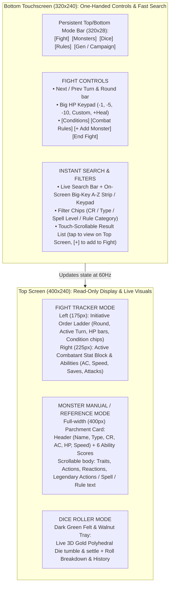
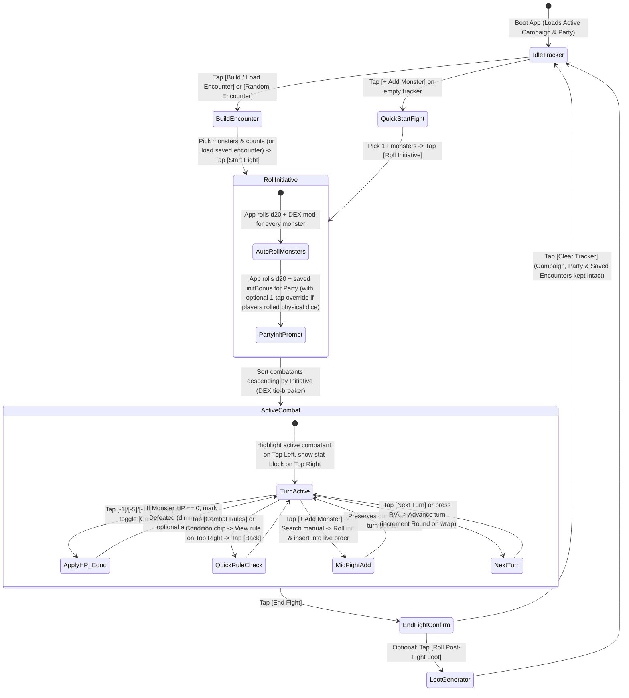

# DM's Toolkit: Research and Architecture Plan

**Target Platform:** Nintendo 3DS (Modded 3DS XL, `.3dsx` and `.cia`)
**Status:** Architecture & Research Plan (Pre-Implementation Review)
**Primary Persona:** The Kitchen Table DM (monsters first, one-handed touchscreen operation, fast lookup)

---

## 1. 3DS Homebrew Toolchain and Libraries

### 1.1 Recommended Toolchain and Graphics Stack

For a text-heavy, dual-screen Nintendo 3DS utility with large tap targets and a live 3D dice roller, the current recommended setup from the devkitPro ecosystem is:

* **Compiler & Toolchain:** `devkitARM` (via `devkitPro` pacman), compiling as **C++17** (`-std=gnu++17 -fno-rtti -fno-exceptions -O2 -march=armv6k -mtune=mpcore -mfloat-abi=hard -mtp=soft`).
* **System Library:** `libctru` for low-level 3DS hardware access: HID touchscreen and button polling (`hidScanInput`, `hidTouchRead`), SDMC filesystem access (`sdmc:/`), RomFS read-only asset mounting (`romfsInit`), and the native system software keyboard (`SwkbdState`) when text entry is needed for campaign/party naming.
* **Graphics & UI Stack:** **`citro2d` combined with `citro3d`** (`-lcitro2d -lcitro3d -lctru -lm`).

#### Why `citro2d` + `citro3d` is the right pick (and why alternatives are rejected)

| Library Option | Status in Current Docs | Verdict for DM's Toolkit |
| :--- | :--- | :--- |
| **`citro2d` + `citro3d`** | Official, actively maintained devkitPro libraries | **Selected.** Hardware-accelerated 2D primitives, texture atlases (`tex3ds`), and built-in system/custom `.bcfnt` font rendering (`C2D_Text`), while exposing the underlying PICA200 3D pipeline (`citro3d`) for the 3D dice roller on the same render target. |
| **`pp2d`** | Deprecated and archived years ago | **Rejected.** `pp2d` was superseded by `citro2d` in official devkitPro distributions. Relying on old `pp2d` tutorials breaks against current `libctru`/`citro3d` headers. |
| **`SDL2` / `sf2d`** | Legacy or high-overhead wrappers | **Rejected.** `sf2d` is long dead; `SDL2` adds unnecessary abstraction overhead and complicates mixed 2D/3D PICA200 rendering across the top (`400x240`) and bottom (`320x240`) screens. |
| **Console `consoleInit`** | Diagnostic text only | **Rejected.** Fixed-grid ASCII terminal cannot render proportional fonts, stat block cards, HP bars, or large touch buttons. |

### 1.2 Building `.3dsx` First and `.cia` Later from the Same Source

Following the proven build architecture in [`kiyoshithekidd/TomodachiLife_3DS_SaveEditior`](https://github.com/kiyoshithekidd/TomodachiLife_3DS_SaveEditior), both `.3dsx` (for the Homebrew Launcher and Citra/Azahar testing) and `.cia` (for direct 3DS HOME Menu installation) are produced from the exact same compiled `.elf` and `romfs/` directory:

1. **Sprite & Asset Pre-build (`tex3ds`):**
   * UI icons, dice textures, and felt/parchment backgrounds in `gfx/` are listed in `gfx/sprites.t3s`.
   * During `make`, `tex3ds` compiles `sprites.t3s` into `romfs/gfx/sprites.t3x` and generates `build/sprites.h` with sprite indices.
2. **`.3dsx` Build (Default `make` target):**
   * Compiles all `source/*.cpp` into `build/*.o` and links `DM_Toolkit.elf` using `-specs=3dsx.specs`.
   * Generates `DM_Toolkit.smdh` (title: `"DM's Toolkit"`, description: `"Tabletop DM Screen & Fight Tracker"`, author: `"KiyoshiTheKidd"`, icon: `icon.png` at `48x48`).
   * Packs `DM_Toolkit.elf`, `DM_Toolkit.smdh`, and `--romfs=romfs` into `DM_Toolkit.3dsx` via `3dsxtool`.
3. **`.cia` Build (`make cia` target, added when ready for HOME Menu packaging):**
   * **`bannertool makesmdh`:** Builds `build/icon.bin` from `icon.png` (`48x48` PNG) and app metadata.
   * **`bannertool makebanner`:** Builds `build/banner.bnr` from `gfx/banner.png` (`256x128` PNG) and `gfx/banner.wav` (under 3-second PCM WAV chime).
   * **`arm-none-eabi-strip`:** Strips debug symbols from `DM_Toolkit.elf` into `build/DM_Toolkit-strip.elf`.
   * **`makerom`:** Assembles `DM_Toolkit.cia` using `app.rsf`:
     ```bash
     makerom -f cia -o DM_Toolkit.cia \
       -elf build/DM_Toolkit-strip.elf \
       -rsf app.rsf \
       -icon build/icon.bin \
       -banner build/banner.bnr \
       -exefslogo -target t
     ```
   * **`app.rsf` Configuration:**
     * `ProductCode`: `CTR-P-DMTK`
     * `UniqueId`: `0xf8c31` (distinct from `0xf8c30` used by the Tomodachi Life Save Editor so both install side-by-side on the same 3DS XL).
     * `RomFs.RootPath`: `romfs`
     * `FileSystemAccess`: `DirectSdmc` (grants direct read/write access to `sdmc:/3ds/DM_Toolkit/` when installed as a `.cia`).
     * `SystemMode`: `64MB`, `CpuSpeed`: `268MHz` (compatible with both Old 3DS and New 3DS XL).

### 1.3 Text Rendering and Search Performance on 3DS Hardware

The ARM11 MPCore CPU on the 3DS runs at 268 MHz (or 804 MHz on New 3DS if enabled, though 268 MHz is plenty when properly architected) and has limited memory bandwidth. The full SRD 5.1 dataset is roughly 3.3 MB of raw JSON text. To guarantee **60 FPS rendering** and **under 1 millisecond search latency**, the app will use three hardware-specific optimizations:

1. **Never Parse JSON at Runtime on the 3DS:**
   * A build-time Python script (`tools/compile_srd.py`) ingests the raw SRD 5.1 JSON files on the host machine, sanitizes terminology, word-wraps or normalizes paragraphs, and emits a flat, memory-mapped binary bundle (`romfs/data/srd.bin`) plus a compact index table (`romfs/data/srd_idx.bin`).
   * At startup, the 3DS loads the lightweight index header (~60 KB for all ~1,280 SRD entries) into RAM in a single `fread`, while keeping full text descriptions either in a contiguous string pool (~1.4 MB in RAM, well within the 64 MB budget) or streamed via `fseek` by byte offset. Loading the entire 1.4 MB binary string pool into RAM at boot takes less than 40 ms from RomFS and eliminates all SD card I/O stalls during a session.
2. **Cache `C2D_Text` Glyphs Instead of Re-Parsing Every Frame:**
   * In `citro2d`, calling `C2D_TextParse()` and `C2D_TextOptimize()` converts UTF-8 strings into GPU glyph quads inside a `C2D_TextBuf`. Doing this for 300+ words of a monster stat block every frame at 60 Hz will bottleneck the CPU.
   * **Solution:** Maintain **two separate `C2D_TextBuf` allocations**:
     * `g_staticTextBuf` (capacity: `8192` glyphs): Cleared and populated **only when the active monster, spell, or rule entry changes** (or when a stat block tab is switched). The pre-wrapped lines are parsed and optimized once, then drawn every frame with `C2D_DrawText()` at near-zero CPU cost (scrolling simply shifts the `y` coordinate with a scissor test via `C3D_SetScissor`).
     * `g_dynamicTextBuf` (capacity: `1024` glyphs): Cleared once per frame (`C2D_TextBufClear`) for dynamic numbers that change frame-to-frame (current HP, initiative roll totals, search bar input cursor, round counter).
3. **Pre-Computed Line Wrapping & Custom `.bcfnt` Font (Optional):**
   * The 3DS system font works out of the box with `citro2d`, and `mkbcfnt` can optionally compile an OFL serif/sans font for headers.
   * Because top-screen stat block cards have a fixed pixel width (`376px` inner content width on the `400px` top screen), line wrapping is computed **once** when an entry is selected into a `WrappedArticle` struct, rather than measuring string widths during the render loop.

---

## 2. SRD 5.1 Data Source, Completeness, and Attribution

### 2.1 Candidate Comparison

We evaluated the top machine-readable SRD 5.1 repositories available on GitHub:

| Dataset Candidate | Repository / Path | Coverage & Structure | Licensing & Pros / Cons |
| :--- | :--- | :--- | :--- |
| **1. `5e-bits/5e-srd-api` (2014 SRD 5.1 Dataset)** *(formerly `5e-bits/5e-database`)* | `packages/5e-database/src/2014/en/5e-SRD-*.json` | **24 clean JSON files:**<br>- 334 Monsters (`1.34 MB`)<br>- 319 Spells (`611 KB`)<br>- 12 Classes + 12 Subclasses<br>- 9 Races + 4 Subraces<br>- 237 Equipment items (Weapons, Armor, Gear)<br>- 362 Magic Items<br>- 15 Conditions, 1 Feat (`Grappler`), Rules & Rule Sections (`246 KB`) | **Recommended Primary Source.**<br>- Code/JSON structure is MIT licensed; content is pure SRD 5.1.<br>- Contains **zero third-party clutter** (strictly official SRD 5.1).<br>- Highly normalized fields (`armor_class`, `hit_points`, `hit_points_roll`, `challenge_rating`, `special_abilities`, `actions`, `legendary_actions`). |
| **2. `open5e/open5e-api`** | `data/v1/wotc-srd/*.json` and `data/v2/wizards-of-the-coast/srd-2014/*.json` | **17 JSON files (v1) / 34 files (v2):**<br>- 322 Monsters (`858 KB`)<br>- 319 Spells (`498 KB`)<br>- Classes, Races, Weapons, Armor, Conditions, Sections | **Secondary Reference Only.**<br>- `v1` is formatted as Django ORM database fixtures (`model`, `pk`, `fields`) with embedded Markdown tables.<br>- `v2` splits every monster into 5 relational tables (`Creature`, `CreatureAction`, `CreatureActionAttack`, `CreatureTrait`), adding unnecessary join complexity. Also mixes SRD 5.2 and third-party sets (Kobold Press, A5E) in neighboring folders. |
| **3. `BTMorton/dnd-5e-srd`** | `json/00 legal.json` .. `16 npcs.json` | Document-hierarchy JSON converted from PDF chapters | Harder to index for structured monster stat blocks (HP, AC, CR filters) because entries are nested inside prose chapters. |

#### Recommendation

Use **`5e-bits/5e-srd-api` (`packages/5e-database/src/2014/en/`)** as the authoritative build-time input dataset. Its schema maps 1:1 to C++ structs for monsters, spells, equipment, classes, races, conditions, and combat rules, and it guarantees 100% purity to the 2014 SRD 5.1 specification.

### 2.2 What Is and Is Not in SRD 5.1 (and How Gaps Are Flagged)

Per the PRD ("Gaps to flag, not hide"), the SRD 5.1 does not contain the full core rulebooks. Specifically:

1. **Classes & Subclasses:** All 12 core classes are included with their full level 1 to 20 progression tables and base features, **plus exactly 1 subclass per class** (Barbarian: *Path of the Berserker*, Bard: *College of Lore*, Cleric: *Life Domain*, Druid: *Circle of the Land*, Fighter: *Champion*, Monk: *Way of the Open Hand*, Paladin: *Oath of Devotion*, Ranger: *Hunter*, Rogue: *Thief*, Sorcerer: *Draconic Bloodline*, Warlock: *The Fiend*, Wizard: *School of Evocation*). Other popular subclasses (such as *Battle Master*, *Eldritch Knight*, *Assassin*, *Arcane Trickster*, *Beast Master*, *Vengeance*, *Moon*, *Wild Magic*, *necromancy/abjuration schools*) are **not in the SRD**.
2. **Feats:** Only **1 feat** (*Grappler*) is in the SRD 5.1 (`5e-SRD-Feats.json`). Well-known feats like *Great Weapon Master*, *Sharpshooter*, *Sentinel*, *Polearm Master*, *War Caster*, and *Lucky* are **not in the SRD**.
3. **Spells:** 319 spells are in the SRD 5.1. Several notable spells (such as *Hex*, *Hunter's Mark*, *Armor of Agathys*, *Chromatics Orb*, *Dissonant Whispers*, *Eldritch Blast* is in SRD, *Arms of Hadar*, *Hail of Thorns*, *Compelled Duel*, *Find Steed* is in SRD, *Wrathful Smite*) and named wizard spells have their proper names stripped in the SRD (for example, *Acid Arrow*, *Arcane Hand*, *Floating Disk*, *Hideous Laughter*, *Instant Summons*, *Irresistible Dance*, *Magnificent Mansion*, *Private Sanctum*, *Secret Chest*, *Telepathic Bond*, *Tiny Hut*) or are omitted entirely.
4. **Monsters:** 334 monsters (including beasts, dragons, undead, fiends, giants, and NPCs like *Archmage*, *Assassin*, *Bandit Captain*, *Cult Fanatic*, *Knight*, *Mage*, *Priest*, *Scout*, *Spy*, *Thug*, *Veteran*) are in the SRD. Protected signature monsters (eye tyrants, squid-headed psionics, displacer panthers, carrion crawlers, umber hulks, yuan-ti abomination, slaad) are **not in the SRD**.
5. **Backgrounds:** Only **1 background** (*Acolyte*) is in the SRD 5.1.

#### How Gaps Are Stored and Flagged in the UI

To prevent the New DM or Kitchen Table DM from thinking the search engine is broken when they type a non-SRD spell, feat, or subclass:

* **Build-Time Alias & Gap Catalog (`data/srd_gaps.json`):** We compile a lightweight table of ~120 common non-SRD terms and SRD renamed aliases into the search index with an entry type of `ENTRY_SRD_GAP` or `ENTRY_SRD_ALIAS`:
  * **Renamed SRD Aliases:** If the DM searches `"Tiny Hut"` or `"Hideous Laughter"`, it matches immediately and opens the SRD spell (*Tiny Hut* or *Hideous Laughter*) with a small banner: `"SRD Open Name: Tiny Hut"`.
  * **Flagged Non-SRD Gaps:** Every Class view includes a `"Subclasses in SRD (1 of N)"` notice listing the included SRD archetype alongside a muted `"Not in Open SRD"` list of core book archetype names. The Feats category displays *Grappler* plus an explicit `"Why is there only 1 feat?"` info card and searchable stub entries for non-SRD feats/spells. When a search hits a stub (e.g., `"Hex"`, `"Hunter's Mark"`, `"Sentinel"`, `"War Caster"`), the result row shows an amber `[Non-SRD]` badge and the top screen displays:
    > **Not Included in Open SRD 5.1**
    > This entry is not part of the open System Reference Document 5.1 under CC-BY-4.0.
    > *(Tip: You can add custom rules or spells in a future Homebrew update, or check your physical rulebook.)*

### 2.3 CC-BY-4.0 Attribution Requirement and IP Sanitization

All SRD 5.1 content is used under the **Creative Commons Attribution 4.0 International License (CC-BY-4.0)**.

1. **Exact Required Legal Attribution:**
   The following verbatim legal notice required by the SRD 5.1 CC-BY-4.0 license will be placed in three locations: (a) `README.md` and `LICENSE`, (b) `romfs/LICENSE_SRD.txt`, and (c) an in-app **Credits & Legal (CC-BY-4.0)** modal accessible from the Home / Campaign screen:
   > This work includes material taken from the System Reference Document 5.1 ("SRD 5.1") by Wizards of the Coast LLC and available at https://dnd.wizards.com/resources/systems-reference-document. The SRD 5.1 is licensed under the Creative Commons Attribution 4.0 International License available at https://creativecommons.org/licenses/by/4.0/legalcode.
2. **Build-Time IP Sanitizer (`tools/compile_srd.py`):**
   * The compiler script scans every string in the compiled database against a strict blocklist of trademarked game titles, publisher system names, campaign setting names, and non-SRD signature monsters outside of the verbatim legal attribution block above.
   * Any spelled-out game master title in SRD rule text is normalized to `"DM"`. The build fails automatically if any blocked term leaks into `srd.bin`.

---

## 3. System Architecture

### 3.1 Project Layout

```text
DM-Toolkit/
├── .github/
│   └── workflows/
│       └── build.yml            # GitHub Actions CI: host QA tests + devkitARM .3dsx & .cia build
├── Makefile                     # devkitARM build rules (all -> .3dsx, make cia -> .cia, make test -> host tests)
├── app.rsf                      # makerom CIA configuration (ProductCode: CTR-P-DMTK, UniqueId: 0xf8c31)
├── icon.png                     # 48x48 application icon for SMDH and CIA
├── PRD.md                       # Product Requirements Document
├── PERSONAS.md                  # User Personas
├── ARCHITECTURE.md              # This Architecture Plan
├── README.md                    # Project summary and CC-BY-4.0 attribution
├── tools/
│   ├── compile_srd.py           # Offline compiler: 5e-SRD-*.json -> romfs/data/srd.bin + srd_idx.bin
│   └── raw_srd/                 # Pinned 2014 SRD 5.1 JSON files from 5e-bits/5e-srd-api
├── gfx/
│   ├── sprites.t3s              # tex3ds atlas manifest
│   ├── banner.png               # 256x128 CIA home menu banner
│   ├── banner.wav               # Short (<3s) audio chime for CIA banner
│   ├── bg/                      # Dark tavern wood, parchment cards, dark green dice tray felt
│   ├── icons/                   # Monster type badges, condition icons, die silhouettes (d4..d100)
│   └── ui/                      # Big touch buttons, +/- HP steppers, tab bars, search bar
├── romfs/
│   ├── LICENSE_SRD.txt          # Required CC-BY-4.0 attribution text bundled into the ROM
│   └── data/
│       ├── srd.bin              # Compiled binary SRD 5.1 database (monsters, spells, rules, gear)
│       ├── srd_idx.bin          # Pre-sorted search trigram/prefix index and filter tables
│       └── generators.bin       # Compiled NPC name tables, loot tables, terrain encounter tables
├── include/
│   ├── app_state.h              # Global state machine, active screen, active campaign pointer
│   ├── srd_types.h              # Fixed-layout binary structs for Monster, Spell, Item, Rule, Gap
│   ├── srd_db.h                 # Zero-allocation lookup, prefix/trigram search, CR/type filter API
│   ├── combat_tracker.h         # Active fight state, initiative sorting, HP delta, on-the-fly add
│   ├── campaign_io.h            # SD card save/load (sdmc:/3ds/DM_Toolkit/campaigns/*.json or .dmtk)
│   ├── dice_roller.h            # 3D polyhedral physics-feel dice roller state & face orientation math
│   ├── generators.h             # Random encounter, NPC name, and post-fight loot generators
│   ├── ui_theme.h               # Bard's toolkit color palette, layout rects, touch hit-testing
│   └── renderer.h               # Dual-screen citro2d + citro3d render pipeline & C2D_Text caching
├── source/
│   ├── main.cpp                 # Entry point, service init, 60Hz main loop, input dispatch
│   ├── srd_db.cpp               # Binary database loader and instant search implementation
│   ├── combat_tracker.cpp       # Fight state machine (Build -> Initiative -> Round Loop -> End)
│   ├── campaign_io.cpp          # Atomic SD card file persistence and default campaign bootstrap
│   ├── dice_roller.cpp          # citro3d 3D polyhedral die rendering and kinematic bounce physics
│   ├── generators.cpp           # Level/terrain encounter builder, NPC name & loot table rollers
│   ├── ui_screens.cpp           # Top and bottom screen rendering for Tracker, Manual, Dice, Reference
│   └── ui_keyboard.cpp          # Custom fast touch QWERTY search keypad + Swkbd wrapper for naming
└── tests/
    └── test_core.cpp            # Host-compiled C++17 unit tests (search, initiative, HP, save I/O)
```

> [!TIP]
> **Host-Testable Core Logic:** Following best practices for 3DS homebrew and the `TomodachiLife_3DS_SaveEditior` release checklist, `srd_db.cpp`, `combat_tracker.cpp`, `campaign_io.cpp`, and `generators.cpp` have zero hard dependencies on `<3ds.h>` or `<citro2d.h>`. They compile natively on Linux/Windows via `g++ -std=c++17` so search speed, initiative sorting, HP math, and IP sanitization can be verified by automated unit tests on every commit.

---

### 3.2 Data Model and SD Card Campaign Saves

#### Compiled SRD Data Model (`include/srd_types.h`)

All pointers inside `srd.bin` are stored as 32-bit `uint32_t` byte offsets into the file's string and array pools so the binary loads directly into memory without pointer fixups or heap fragmentation:

```cpp
enum EntryCategory : uint8_t {
    CAT_MONSTER   = 0,
    CAT_SPELL     = 1,
    CAT_RULE      = 2,   // Includes Combat Actions, Conditions, General Rules
    CAT_CLASS     = 3,
    CAT_RACE      = 4,
    CAT_EQUIPMENT = 5,   // Weapons, Armor, Adventuring Gear, Magic Items
    CAT_SRD_GAP   = 6    // Flagged non-SRD stub or renamed SRD alias
};

enum MonsterType : uint8_t {
    MT_ABERRATION, MT_BEAST, MT_CELESTIAL, MT_CONSTRUCT, MT_DRAGON,
    MT_ELEMENTAL, MT_FEY, MT_FIEND, MT_GIANT, MT_HUMANOID,
    MT_MONSTROSITY, MT_OOZE, MT_PLANT, MT_UNDEAD, MT_COUNT
};

// Bitmask for the 15 SRD conditions (fits in a single uint16_t per combatant)
enum ConditionBit : uint16_t {
    COND_BLINDED       = (1 << 0),
    COND_CHARMED       = (1 << 1),
    COND_DEAFENED      = (1 << 2),
    COND_EXHAUSTION    = (1 << 3),
    COND_FRIGHTENED    = (1 << 4),
    COND_GRAPPLED      = (1 << 5),
    COND_INCAPACITATED = (1 << 6),
    COND_INVISIBLE     = (1 << 7),
    COND_PARALYZED     = (1 << 8),
    COND_PETRIFIED     = (1 << 9),
    COND_POISONED      = (1 << 10),
    COND_PRONE         = (1 << 11),
    COND_RESTRAINED    = (1 << 12),
    COND_STUNNED       = (1 << 13),
    COND_UNCONSCIOUS   = (1 << 14)
};

struct MonsterActionRef {
    uint32_t nameOffset;        // e.g. "Multiattack", "Scimitar", "Shortbow"
    uint32_t summaryOffset;     // Compact 1-line summary for Tracker view: "+4 to hit, 5 (1d6+2) slashing"
    uint32_t fullDescOffset;    // Full SRD text for Manual view
    int8_t   attackBonus;       // e.g. +4 (or -128 if not an attack roll)
    uint8_t  sectionType;       // 0 = Trait, 1 = Action, 2 = Reaction, 3 = Legendary Action
};

struct MonsterRecord {
    uint16_t id;                // 0..333
    uint32_t nameOffset;
    uint32_t sizeAndAlignOffset;
    MonsterType type;
    uint8_t  crIndex;           // 0 = CR 0, 1 = 1/8, 2 = 1/4, 3 = 1/2, 4 = CR 1 .. 33 = CR 30
    uint16_t xp;
    uint16_t armorClass;
    uint32_t acNoteOffset;      // e.g. "natural armor", "leather armor, shield"
    uint16_t hitPoints;
    uint32_t hitDiceOffset;     // e.g. "2d6"
    uint32_t speedOffset;       // e.g. "30 ft., fly 60 ft."
    uint8_t  strScore, dexScore, conScore, intScore, wisScore, chaScore;
    int8_t   initBonus;         // Precomputed floor((dexScore - 10) / 2)
    uint32_t savesOffset;       // e.g. "Con +6, Int +8, Wis +6"
    uint32_t skillsOffset;      // e.g. "History +12, Perception +10"
    uint32_t defensesOffset;    // Resistances, Immunities, Vulnerabilities
    uint32_t sensesLangOffset;  // Darkvision, Passive Perception, Languages
    uint16_t firstActionIdx;    // Index into MonsterActionRef array
    uint8_t  actionCount;
    uint16_t terrainMask;       // Bitmask of terrains for random encounter generator
};
```

Similar compact structs (`SpellRecord`, `EquipmentRecord`, `RuleRecord`, `ClassRecord`, `RaceRecord`) store the remaining SRD categories, all unified under a common `SearchIndexEntry` struct for instant global or category-filtered search.

#### Runtime Models: Party, Encounters, and Active Fight (`include/combat_tracker.h`)

```cpp
struct PartyMember {
    char     name[32];          // e.g. "Lirael"
    int8_t   initBonus;         // e.g. +3
    uint8_t  level;             // Party level (1..20), used by random encounter generator
    uint8_t  ac;                // Optional quick reference AC
    bool     activeInParty;     // Included when rolling initiative
};

struct EncounterMonsterSlot {
    uint16_t monsterId;         // ID in MonsterRecord table (0..333)
    uint8_t  count;             // Number of this monster in the encounter (1..20)
};

struct SavedEncounter {
    char     name[40];          // e.g. "Goblin Ambush at River"
    uint8_t  slotCount;
    EncounterMonsterSlot slots[12];
};

struct Combatant {
    char     displayName[36];   // e.g. "Goblin 1", "Goblin 2", "Lirael"
    bool     isPlayer;          // true = saved party member, false = monster
    uint16_t monsterId;         // 0xFFFF for players, 0..333 for SRD monsters
    int8_t   initRoll;          // Total initiative score (d20 + initBonus)
    int8_t   initBonus;         // Tie-breaker and modifier
    int16_t  currentHp;         // Tracked for monsters (players track their own HP per PRD)
    int16_t  maxHp;
    uint8_t  armorClass;
    uint16_t conditionsMask;    // Bitmask of ConditionBit (Poisoned, Prone, Stunned, etc.)
};
```

#### Campaign Save Files on the SD Card (`include/campaign_io.h`)

* **Directory Location:** `sdmc:/3ds/DM_Toolkit/campaigns/`
  * Both `.3dsx` and `.cia` builds (with `DirectSdmc` in `app.rsf`) have full read/write access to `sdmc:/3ds/DM_Toolkit/`.
  * On first boot, if `sdmc:/3ds/DM_Toolkit/campaigns/` does not exist, the app creates the directory and writes a starter campaign (`campaign_01.json`, named `"Starter Campaign"`) with a sample 4-hero party and 2 sample preplanned encounters so the DM can test the fight tracker immediately.
* **One File Per Campaign:** Each campaign is stored as a standalone, human-readable JSON file (`sdmc:/3ds/DM_Toolkit/campaigns/<slug>.json`, e.g., `sunken_citadel.json`), alongside a small `sdmc:/3ds/DM_Toolkit/settings.json` that remembers `last_opened_campaign`.
* **Why JSON for Campaign Saves?** Unlike the 3.3 MB SRD database, a campaign save file is tiny (under **4 KB**). Saving it as clean, self-contained JSON means:
  1. Parsing takes under 0.5 ms using a lightweight single-header parser (`jsmn` or a 150-line recursive descent reader).
  2. The DM can pop the SD card into a PC or use FTPD on their 3DS to back up, edit, or pre-type campaign rosters and encounter lists in any text editor.
  3. Atomic writes (`write to <slug>.json.tmp` -> `rename to <slug>.json`) prevent save corruption if the 3DS battery dies mid-session.
* **What Each Campaign File Holds:**
  1. `campaign_name` (string) and `last_played_timestamp`.
  2. `party_level` (1..20, used as the default for the Random Encounter Generator and Loot Generator).
  3. `party` array (up to 8 `PartyMember` entries: `name`, `init_bonus`, `ac`, `active`).
  4. `encounters` array (up to 32 `SavedEncounter` presets: `name`, list of `{ monster_index, count }`).
  5. `active_fight` object (optional auto-saved snapshot of the current round, active turn index, and combatant HP/initiative/conditions so closing the 3DS shell or exiting to the HOME Menu mid-combat never loses the current fight).

---

### 3.3 Dual-Screen UI Layout

The UI is styled as a **warm tavern / bard's toolkit** (parchment cards `#FAF3E0`, dark walnut frames `#241710`, antique gold accents `#D4AF37`, blood-red HP badges `#9E1B1B`, emerald felt `#123524`), avoiding sterile spreadsheet grids.

Every bottom-screen touch target is at least **`44x36` pixels** (with `64x44` primary action buttons) for effortless one-handed thumb or stylus use while the DM's other hand holds notes or physical dice.



#### Screen-by-Screen Breakdown

1. **Fight Tracker (The Home Screen):**
   * **Top Screen (`400x240`):** Split into two side-by-side panels so the DM never leaves the fight to check what a monster does:
     * **Left Column (`176px` wide):** The **Initiative Ladder**. Shows `Round N` at the top, followed by the sorted list of combatants (7 visible rows at a time, auto-scrolling to keep the current turn centered). Each row shows the initiative score badge, combatant name (`Goblin 1`, `Lirael`), an HP fraction + color bar for monsters (`7/7`), and compact condition badges (`PSN`, `PRN`, `STN`).
     * **Right Column (`224px` wide):** The **Active/Selected Monster Inspector**. When a monster is highlighted (defaults to whoever's turn it is, or whichever combatant the DM taps/selects), this panel immediately shows its AC, HP, Speed, `STR/DEX/CON/INT/WIS/CHA` modifiers, Saving Throws, Resistances/Immunities, and its **Actions & Abilities** (e.g., *Nimble Escape*, *Scimitar: +4 to hit, 5 (1d6+2) slashing*). `L / R` shoulder buttons or `Up / Down` on the Circle Pad scroll the right-hand ability text if a boss monster has a long stat block.
   * **Bottom Touchscreen (`320x240`):**
     * **Top Strip (`28px`):** Mode switcher tabs (`[Fight]`, `[Manual]`, `[Dice]`, `[Rules]`, `[Tools]`).
     * **Selected Combatant Control Deck (`116px`):** Displays the selected combatant's name, current HP, and **huge one-tap HP adjustment buttons**: `[-10] [-5] [-1] [+1] [+5] [Custom +/-]`. Also includes a **`[Conditions]`** pill that opens a 15-chip toggle overlay (Poisoned, Prone, Stunned, Grappled, etc.) right on the bottom screen.
     * **Quick Combat Action Bar (`52px`):** Four large action buttons:
       * **`[NEXT TURN]`** (or `A` / `R` button): Advances initiative order and increments the round counter at the bottom of the order.
       * **`[+ ADD MONSTER]`**: Opens the Monster Manual search overlay to drop reinforcement monsters directly into the active initiative order mid-fight.
       * **`[COMBAT RULES]`**: One-tap pop-up reference drawer on the top screen showing Actions in Combat (Attack, Cast a Spell, Dash, Disengage, Dodge, Help, Hide, Ready, Search, Use an Object), Bonus Actions, Opportunity Attacks, Cover, and the 15 Conditions. Tap `[Back]` or `B` to return immediately to the monster stat block.
       * **`[END FIGHT]`**: Prompts a single confirmation tap (`[Confirm End Fight]` / `[Roll Loot]`), clears the active combat tracker, and preserves the campaign.

2. **Monster Manual & Encounter Builder:**
   * **Top Screen (`400x240`):** Full-width parchment stat block of the currently highlighted monster. Divided into clean visual sections: Banner (Name, Size/Type/Alignment, CR & XP), Vitals Bar (AC, HP & Hit Dice, Speed), 6-Column Ability Score Box (`STR`..`CHA` with score and modifier), Defenses/Senses/Languages, and scrollable Traits/Actions/Legendary Actions.
   * **Bottom Touchscreen (`320x240`):**
     * **Instant Search Bar + Filter Pills:** Type a few letters on the built-in bottom-screen quick-type strip (or tap filter pills for **Type**: *All, Undead, Fiend, Dragon, Humanoid, Beast...* and **CR**: *All, 0-1, 2-4, 5-10, 11+*).
     * **Scrollable Results List (4 to 5 big rows):** Each row shows `Monster Name`, `Type`, `CR`, and a **`[+ Fight]`** button on the right edge. Tapping a row previews the full stat block on the top screen; tapping `[+ Fight]` increments that monster's count in the current encounter or drops it into the live fight.

3. **Rules Reference (Pocket SRD):**
   * **Top Screen (`400x240`):** Full formatted entry for the selected Spell (Level, School, Casting Time, Range, Components, Duration, Classes, Description, At Higher Levels), Condition, Weapon/Armor table, Class progression & features, or Race traits. If the selected entry is a flagged non-SRD stub, shows the amber **Not in Open SRD 5.1** explanation card.
   * **Bottom Touchscreen (`320x240`):**
     * **Category Tabs:** `[All]`, `[Spells]`, `[Combat & Conditions]`, `[Classes & Races]`, `[Gear & Items]`.
     * **Same Instant Search Bar & Result List** as the Monster Manual so muscle memory is identical across the whole app.

---

### 3.4 State Flow for a Fight



Key design details in the fight loop:
* **Grouped or Individual Monster Initiative (1-Tap Toggle):** By default, identical monsters (e.g., `Goblin 1`, `Goblin 2`, `Goblin 3`) can either share one initiative roll per monster type (standard table speed-up for Kitchen Table DMs) or roll individually. Each monster still tracks its own individual HP (`Goblin 1: 7/7`, `Goblin 2: 2/7`) and conditions.
* **Party Initiative Flexibility:** When an encounter starts, the app automatically rolls `1d20 + initBonus` for every active party member so the fight can start in one second. If the players at the kitchen table rolled their own physical d20s, the DM can tap any party member's initiative badge on the setup card and tap a 1-to-30 number pad to set their exact roll before or during round 1.
* **Mid-Fight Reinforcements (`+ Add Monster`):** Adding a monster during Round 3 rolls its initiative immediately, inserts it into the sorted `Combatant` vector at the proper initiative slot, and adjusts `currentTurnIndex` if the new monster landed above the current actor so the active turn never jumps to the wrong creature.

---

### 3.5 Dice Roller: Physics-Feel Roll on 3DS (Approach & Tradeoff Analysis)

We inspected the reference implementation in `kiyoshithekidd/college-of-keys` (`d20-roller.js`), which uses Three.js and `cannon-es` to roll a gold metallic icosahedron (`#ffe875` to `#8a6412` radial gradient with dark engraved numbers and underlined 6/9) inside a dark green felt and walnut tray, reading the top face via the dot product of rotated face normals against the world up vector (`+Y`).

On the Nintendo 3DS, we do not have JavaScript, Three.js, or `cannon-es`. We have the **PICA200 hardware 3D GPU (`citro3d`)** and **`citro2d`**. Here are the two engineering approaches and their tradeoffs:

| Criteria | Approach A: Kinematic 3D Polyhedral Physics via `citro3d` (Recommended) | Approach B: 2D Sprite Flipbook / Pre-Rendered Animation via `citro2d` |
| :--- | :--- | :--- |
| **Visual Fidelity to Spec** | **Exact match.** Draws live 3D polyhedral meshes (`d4, d6, d8, d10, d12, d20`) with a gold metallic texture atlas over the dark green felt tray. The die physically tumbles in 3D `(x, y, z)`, bounces off the 4 walnut tray walls and felt floor with restitution and friction, and settles onto the actual winning 3D face. | **Low.** A 2D sprite spinning or cycling numbers looks flat and synthetic, losing the tabletop tactile feel required by the PRD and Kitchen Table DM persona. |
| **Implementation Complexity** | **Low-to-Moderate (~350 lines of C++).** Instead of porting a general-purpose rigid-body engine like Bullet or Cannon (which is overkill for 1 or 2 convex dice in a flat box), we use **impulse-based rigid-body kinematics + analytical quaternion face-alignment**. | **Very Low (~120 lines of C++).** Just draws 2D sprites from `sprites.t3x` with a timer. |
| **Performance on 3DS** | **60 FPS locked (<5% CPU/GPU).** A `d20` is only 20 triangles (60 vertices). Even rolling two `d20`s for Advantage/Disadvantage is 40 triangles, which the PICA200 hardware renders in microseconds. | **60 FPS locked (<1% CPU/GPU).** |
| **ROM / Asset Size** | **Tiny (~32 KB).** Uses a single 5x4 gold triangle/square number texture atlas + procedural vertex arrays for the 5 Platonic solids and pentagonal trapezohedron (`d10`). | **Large (~500 KB+).** Requires dozens of pre-rendered rotation frames for 6 different die shapes. |

#### Recommended Architecture for the 3DS Physics-Feel Dice Roller

We recommend **Approach A: Lightweight 3D Polyhedral Rigid-Body Kinematics on `citro3d`/`citro2d`**, translating the exact design and math of `college-of-keys/d20-roller.js` into native C++ without a heavy third-party physics engine:

1. **Live 3D Mesh & Gold Atlas:**
   * All 6 polyhedral die meshes (`d4` tetrahedron, `d6` cube, `d8` octahedron, `d10/d100` decahedron, `d12` dodecahedron, `d20` icosahedron) are defined as static const vertex/normal/UV arrays in `source/dice_roller.cpp`.
   * Opposite faces on the `d20` are paired to sum to 21 (and `d6` to 7, `d8` to 9, `d12` to 13), mapped to a pre-baked `5x4` gold metallic numbered texture atlas (`#ffe875` center highlight, `#d4af37` gold body, `#8a6412` bevel edge, dark obsidian serif numerals with underlined `6` and `9`).
2. **Tray Wall Bounces & Settle Physics:**
   * When the DM taps a die (or shakes/flicks via touchscreen), the die spawns with random 3D linear velocity $\vec{v}$ and angular velocity $\vec{\omega}$.
   * Each 60 Hz frame integrates position $\vec{p}$, bounces off the felt floor ($z = 0$, restitution $e = 0.45$) and the four walnut tray walls ($x \in [-W, W], y \in [-H, H]$, restitution $e = 0.6$), and applies angular damping as the die touches the felt.
   * **True Face Settle & Outcome:** Just like `college-of-keys`, each face has an outward local normal $\hat{n}_i$. As the die slows down during the final 25% of its bounce, a gentle corrective torque slerps the nearest face normal (or the cryptographically/hardware-seeded target face's normal) to align flush with the camera/table normal $(0, 0, 1)$, so the die never balances awkwardly on an edge and the top face drawn on screen **always matches the rolled number**.
3. **Advantage, Disadvantage, and Modifiers:**
   * Selecting **Advantage** or **Disadvantage** rolls **two 3D gold d20s simultaneously** in the tray (with simple sphere-sphere collision repulsion so they clack off each other), highlights the kept die in bright gold and dims the dropped die, and displays the full breakdown (`d20 (17, 8) [Adv] + 4 = 21`).

---

### 3.6 Search Architecture: Keeping Lookups Instant on 3DS Hardware

Per the PRD: *"Search is the primary way in: type a few letters, get the monster, spell, or rule... The hard part is making search fast on the small touchscreen, not fitting the data."*

Opening the 3DS OS software keyboard (`swkbd`) pauses the entire app, blacks out the top screen, requires tapping "OK" to dismiss, and prevents live search-as-you-type previews. While `swkbd` is great for one-time text entry (naming a campaign or party member), **using `swkbd` for monster and rule search would fail the Kitchen Table DM persona**.

Instead, DM's Toolkit uses a **Always-Live Bottom-Screen Touch Keypad + Pre-Indexed Prefix & Substring Engine**:

1. **Instant Search-As-You-Type UI (No Modal Blocking):**
   * In the Manual and Reference modes, the bottom screen features a compact, big-button QWERTY thumb keyboard (or collapsible 3-row letter bar with `Backspace` and `Clear`) sitting directly below the top 3-4 matching results.
   * With every single letter tapped (e.g., `G` -> `O` -> `B`), the result list filters **on that exact frame** and the top screen immediately displays the #1 matching stat block (*Goblin*). In 90% of lookups, typing just **2 or 3 letters** brings the desired monster or spell into the top 3 visible tap rows without ever pressing an "Enter" key.
2. **Two-Tier Search Ranking Algorithm (`source/srd_db.cpp`):**
   * At build time, `compile_srd.py` generates `srd_idx.bin` containing all ~1,280 entries (334 monsters, 319 spells, 237 equipment items, 362 magic items, 15 conditions, rules, classes, races, and ~120 non-SRD gap stubs).
   * Each `SearchIndexEntry` (24 bytes) holds:
     * `char normalizedName[32]` (pre-lowercased ASCII, stripped of punctuation)
     * `uint64_t charBitmask` (a 26-bit bloom filter of which letters `a..z` appear anywhere in the name)
     * `EntryCategory category`, `uint16_t recordId`, `uint8_t crOrLevel`, `uint8_t subType`
   * When the user types a query string $Q$ (plus any active category, monster type, or CR filter):
     1. Compute the query's 26-bit character mask `qMask`.
     2. Scan the contiguous 1,280-entry array (~30 KB, fits entirely in the ARM11 L1/L2 cache):
        * **Fast Reject:** If `(entry.charBitmask & qMask) != qMask` or category/CR filters don't match, skip in **2 CPU instructions**.
        * **Tier 1 Match (Exact Prefix):** `strncmp(entry.normalizedName, Q, qLen) == 0` -> Score `1000 - nameLen`.
        * **Tier 2 Match (Word-Boundary Prefix, e.g., `"dragon"` matching `"Adult Red Dragon"`):** -> Score `500 - wordPos`.
        * **Tier 3 Match (Substring):** `strstr(entry.normalizedName, Q) != nullptr` -> Score `200 - matchOffset`.
   * **Benchmark on 268 MHz ARM11:** Scanning 1,280 cache-hot entries with bitmask pre-filtering executes in **~0.08 milliseconds (80 microseconds)**, which is more than **200x faster** than a single 60 Hz frame (`16.6 ms`).

---

## 4. Recommendations for the Three Open Decisions in the PRD

### Decision 1: Conditions tracking on monsters (stunned, poisoned, prone) or HP only for v1?

* **Recommendation:** **Include lightweight Conditions tracking on monsters (and party rows) in v1**, alongside HP.
* **Reasoning:**
  1. **Zero Friction for the Kitchen Table DM:** In 5th edition combat, conditions (*Prone*, *Poisoned*, *Grappled*, *Restrained*, *Stunned*, *Frightened*, *Concentrating*) happen in almost every fight from level 1 onward. If the tracker only records HP, the DM still needs scrap paper or plastic rings just to remember that `Goblin 2` is *Prone* or `Ogre 1` is *Frightened*.
  2. **Trivial Memory and UI Cost:** There are only 15 conditions in the SRD. Storing them as a `uint16_t conditionsMask` adds **2 bytes** per combatant. In the UI, tapping a single **`[Conditions]`** button on the bottom screen flips the damage keypad into a 3x5 grid of big toggle pills (`Prone`, `Poisoned`, `Grappled`, `Stunned`, etc.). Active conditions show as 3-letter colored badges (`PRN`, `PSN`, `STN`) on the top-screen initiative row.
  3. **Direct Synergy with the Combat Rules Drawer:** Tapping an active condition badge (or holding a condition pill) immediately displays that condition's exact SRD bullet points on the top-right inspector panel, answering *"Wait, does Prone give disadvantage on ranged attacks?"* in one tap.

### Decision 2: Reference data baked into the app, or loaded from editable files so the DM can add homebrew entries?

* **Recommendation:** **Bake the core SRD 5.1 data into a read-only `romfs:/data/srd.bin` binary for v1, AND support an optional SD card JSON overlay directory (`sdmc:/3ds/DM_Toolkit/homebrew/`) loaded at startup for all entry types.**
* **Reasoning:**
  1. **Why Core SRD Must Be Baked into RomFS (`srd.bin`):** Reading 1,280+ entries from loose, editable JSON files on a FAT32 SD card at boot would take several seconds of slow SD I/O and risk accidental corruption of official SRD stats. Packing the compiled `srd.bin` into `romfs:/` keeps the public repository and releases 100% strictly SRD 5.1 under CC-BY-4.0, self-contained, and instant to boot (<40 ms).
  2. **Full All-Entry-Type SD Card Overlay (`sdmc:/3ds/DM_Toolkit/homebrew/`):** We are already writing a lightweight JSON reader for `sdmc:/3ds/DM_Toolkit/campaigns/*.json`. At startup, `srd_db.cpp` scans `sdmc:/3ds/DM_Toolkit/homebrew/*.json` (supporting `monsters`, `spells`, `feats`, `subclasses`, `classes`, `races`, and `equipment` arrays) and merges any user-supplied entries into the live search index and Fight Tracker in RAM.
  3. **Seamless Gap Override:** If a user-supplied SD card entry matches the name of a built-in `[Non-SRD]` gap stub, the SD card entry automatically supersedes the stub in search results. This keeps v1 scope completely free of an on-device Homebrew Editor UI (deferred to post-v1), keeps the public repository strictly CC-BY-4.0 compliant, and gives the **Homebrew DM** persona full extensibility on their personal SD card from day one.

### Decision 3: Dice physics: reuse the College of Keys physics roller approach, or a simpler roll animation for v1?

* **Recommendation:** **Adapt the College of Keys 3D polyhedral physics-feel approach (`citro3d` 3D gold die meshes + tray wall bounces + face-normal orientation math) for v1, rather than a flat 2D sprite animation.**
* **Reasoning:**
  1. **Persona & PRD Mandate:** `PERSONAS.md` states *"Flavor is a requirement, not decoration: the app should feel like a bard's toolkit, not a spreadsheet... The dice roller has to feel like real dice."* A flat 2D sprite flipbook feels like a cheap calculator.
  2. **Low Complexity When Adapted to `citro3d`:** In `college-of-keys` (`d20-roller.js`), the visual magic comes from three simple ingredients: (a) a low-poly 3D polyhedron with a gold metallic numbered texture atlas (`#ffe875` to `#8a6412`), (b) bouncing inside a dark green felt and walnut tray box, and (c) matching each face's 3D normal vector to the rolled value. Writing a 300-line single-die kinematic bounce solver and rendering 20-triangle meshes in `citro3d` takes roughly one afternoon of coding during Slice 2, requires no heavy external physics library, and runs at a locked 60 FPS on the 3DS GPU.

---

## 5. Phased Build Plan

### Slice 1: Monster Manual, Fight Tracker, and Campaign Saves (Priority 1)

Slice 1 delivers the core gameplay loop for the Kitchen Table DM: building or loading an encounter, searching the 334 SRD monsters, rolling initiative alongside the saved party, tracking HP and conditions round by round with monster abilities always visible, and saving campaigns to the SD card.

#### Files and Components Touched in Slice 1

* **Build & Packaging Infrastructure:**
  * `Makefile`, `app.rsf`, `.github/workflows/build.yml`, `icon.png`, `gfx/sprites.t3s`, `romfs/LICENSE_SRD.txt`
* **Offline SRD Compiler & Monster/Combat Rule Data:**
  * `tools/compile_srd.py` (compiles `5e-SRD-Monsters.json`, `5e-SRD-Conditions.json`, and core Combat Action rules into `romfs/data/srd.bin` and `srd_idx.bin` with automated IP blocklist verification)
* **Core Engine & Data Layer:**
  * `include/srd_types.h`, `include/srd_db.h`, `source/srd_db.cpp` (binary loader, instant prefix/substring search, Monster Type & CR filters, optional SD homebrew JSON overlay loader)
  * `include/combat_tracker.h`, `source/combat_tracker.cpp` (encounter setup, automatic + manual initiative, turn progression, HP damage/heal clamping, 15-condition bitmask toggles, mid-fight monster insertion)
  * `include/campaign_io.h`, `source/campaign_io.cpp` (multi-campaign save/load in `sdmc:/3ds/DM_Toolkit/campaigns/*.json`, party roster editor, preplanned encounter saving, active fight auto-save)
* **3DS Dual-Screen UI & Renderer:**
  * `include/app_state.h`, `include/ui_theme.h`, `include/renderer.h`, `source/main.cpp`, `source/ui_screens.cpp`, `source/ui_keyboard.cpp` (Fight Tracker dual-column top screen, Monster Manual full stat block view, 1-tap Combat Rules drawer, bottom-screen big HP keypad, Condition toggle grid, and live touch search keypad)
* **Automated Host Tests:**
  * `tests/test_core.cpp` (unit tests for SRD binary integrity, IP term compliance, <1ms search ranking, initiative sorting, mid-fight insertion, HP/condition math, and campaign JSON serialization)

#### What "Done" Looks Like for Slice 1

1. `make test` compiles and passes all host C++17 unit tests with 0 warnings; `compile_srd.py` verifies all 334 SRD monsters and 15 conditions with zero forbidden IP terms.
2. `make` and `make cia` cleanly produce `DM_Toolkit.3dsx` and `DM_Toolkit.cia` inside the `devkitpro/devkitarm` container.
3. The DM can create/switch campaigns, edit their party's names and initiative bonuses, save preplanned encounters, or launch a fight on the fly.
4. During a fight, the top screen simultaneously shows the initiative order (left) and the active/selected monster's full abilities and attacks (right), while the bottom touchscreen handles 1-tap HP damage/healing, condition badges, mid-fight monster additions, and a 1-tap Combat Rules pop-up drawer.

#### Slice 1 Real-Hardware Playtest Checklist (Modded 3DS XL)

- [ ] **Boot & Campaign Bootstrap:** Launch `DM_Toolkit.3dsx` from the Homebrew Launcher on a modded 3DS XL. Verify it boots in under 1 second and creates `sdmc:/3ds/DM_Toolkit/campaigns/starter_campaign.json` without freeze or flicker.
- [ ] **One-Handed Monster Search:** Hold the 3DS XL in one hand. Tap `[Monsters]`, type `g-o-b` on the bottom-screen touch keypad, and confirm *Goblin*, *Goblin Boss*, and *Hobgoblin* appear instantaneously (<1 frame) with *Goblin*'s full stat block rendered legibly on the top screen.
- [ ] **Filter by Type & CR:** Filter monsters by `Undead` and `CR 0-1`; confirm *Skeleton*, *Zombie*, and *Shadow* filter cleanly and scroll at a locked 60 FPS with no text stutter (`C2D_Text` cache working).
- [ ] **Preplanned Encounter & Campaign Save:** Build an encounter with `3x Goblin` and `1x Bugbear`, save it to the campaign, create a second campaign (`"Test Campaign 2"`), switch between them, and confirm the party roster and saved encounters switch cleanly and persist across app restarts.
- [ ] **Fight Loop & Initiative:** Start the saved encounter. Confirm initiative rolls automatically for the party and monsters, sorts descending with DEX tie-breakers, and allows 1-tap manual override of a player's initiative roll.
- [ ] **Mid-Fight HP, Abilities & Conditions:** Apply `-5` damage to `Goblin 1`, toggle `Prone` and `Poisoned` on `Bugbear 1`, and verify that tapping `Bugbear 1` immediately shows its *Brute*, *Surprise Attack*, *Morningstar*, and *Javelin* abilities on the top-right screen without leaving the tracker.
- [ ] **On-the-Fly Reinforcement:** In Round 2, tap `[+ Add Monster]`, add `1x Wolf` mid-fight, and verify it rolls initiative and inserts into the ladder without corrupting the current active turn pointer.
- [ ] **1-Tap Combat Rules Drawer:** Tap `[Combat Rules]` mid-turn, check the *Grappled* / *Opportunity Attack* rule on the top screen, and tap `[Back]` (or `B`) to return immediately to the fight.
- [ ] **End Fight & Shell Close Recovery:** Close the 3DS XL lid mid-fight (sleep mode), reopen it, verify 60 FPS recovery, then tap `[End Fight]` and confirm the tracker clears while the campaign and party remain saved.

---

### Slice 2: 3D Physics-Feel Dice Roller, Generators, and Full Rules Reference (Priority 2)

Slice 2 completes the v1 toolkit by expanding the SRD compiler to include all 319 Spells, 12 Classes/Subclasses, 9 Races, 237 Equipment items, 362 Magic Items, General Rules, and flagged SRD Gap stubs, while adding the 3D gold-on-felt dice roller and the three tabletop generators (Random Encounters by party level/terrain, NPC Names, and Post-Fight Loot).

#### Files and Components Touched in Slice 2

* **Offline SRD Compiler Expansion & Generator Tables:**
  * `tools/compile_srd.py` (adds `5e-SRD-Spells.json`, `5e-SRD-Classes.json`, `5e-SRD-Subclasses.json`, `5e-SRD-Races.json`, `5e-SRD-Equipment.json`, `5e-SRD-Magic-Items.json`, `5e-SRD-Rules.json`, `5e-SRD-Feats.json`, plus `data/srd_gaps.json` into `romfs/data/srd.bin` and `romfs/data/generators.bin`)
* **3D Polyhedral Dice Roller:**
  * `include/dice_roller.h`, `source/dice_roller.cpp` (`citro3d` 3D mesh renderer for `d4, d6, d8, d10, d12, d20, d100`, 5x4 gold metallic face atlas, kinematic tray wall/floor bounce physics, quaternion face-normal alignment, modifiers `-10..+20`, Advantage/Disadvantage dual-d20 rolls, and roll history log)
* **Tabletop Generators:**
  * `include/generators.h`, `source/generators.cpp`:
    * **Random Encounter Generator:** Uses party size & party level (from the active campaign) + selected terrain (*Dungeon, Forest, Caves/Underground, Road/Grassland, Swamp, Mountain, Coastal, Urban*) and difficulty (*Easy, Medium, Hard, Deadly*) using SRD XP thresholds to roll a thematic monster group and drop it straight into the Fight Tracker or save it to the campaign.
    * **NPC Name & Trait Generator:** Rolls first/surname combinations by fantasy ancestry/culture plus a quick 1-line voice/mannerism hook for on-the-spot improvisation.
    * **Loot Generator:** Rolls individual pocket coinage or treasure hoard coins + SRD gems/art objects + magic items scaled by encounter CR tier (`CR 0-4`, `CR 5-10`, `CR 11-16`, `CR 17+`), accessible both from the `[Tools]` tab and via the `[Roll Loot]` button when ending a fight.
* **Pocket SRD Rules Reference UI & Gap Flagging:**
  * `source/ui_screens.cpp`, `source/srd_db.cpp` (Rules Reference category tabs for Spells, Classes & Races, Gear & Magic Items, and Combat/Conditions; formatted spell cards; amber `[Non-SRD]` gap cards and SRD renamed spell alias banners; Credits & CC-BY-4.0 Legal modal)
* **Automated Host Tests & Release Packaging:**
  * `tests/test_core.cpp` (unit tests for 3D die face-normal dot-product verification across all 6 die shapes, Advantage/Disadvantage math, XP budget encounter generation, and SRD gap/alias lookup)

#### What "Done" Looks Like for Slice 2

1. All 319 SRD spells, 12 classes, 9 races, 599 equipment/magic items, 15 conditions, and combat rules are searchable in under 1 ms with clear `[Non-SRD]` flagging for omitted subclasses, feats, and spells.
2. The Dice Roller renders live 3D gold polyhedral dice (`d4` through `d100`) tumbling and settling on dark green felt inside a walnut border, supporting modifiers and dual-die Advantage/Disadvantage rolls.
3. The Random Encounter, NPC Name, and Loot generators work with 1 tap and integrate directly with the active campaign's party level and Fight Tracker.
4. Both `.3dsx` and `.cia` packages build cleanly in CI and pass the full hardware playtest checklist.

#### Slice 2 Real-Hardware Playtest Checklist (Modded 3DS XL)

- [ ] **3D Physics-Feel Dice Roller:** Open `[Dice]`, tap `d20`, and verify the gold 3D icosahedron tumbles smoothly at 60 FPS across the dark green felt tray, bounces off the walnut walls, and settles with the top face matching the announced result.
- [ ] **All Dice Shapes, Modifiers & Advantage:** Test `d4, d6, d8, d10, d12, d20, d100` with a `+5` modifier and `Advantage` enabled (confirming two 3D gold d20s roll together, clack off each other, and highlight the higher die).
- [ ] **Spell & Rule Lookup Speed:** Open `[Rules]`, type `f-i-r-e` to pull up *Fireball* (checking casting time, range, `8d6` damage, and scaling on the top screen), then type `g-r-a-p` to check *Grappled* and *Grappler*.
- [ ] **SRD Gap & Alias Verification:** Search `"Tiny Hut"` and confirm it resolves to the SRD *Tiny Hut* spell with the alias banner. Search `"Hex"` or `"Sentinel"` (or view the Feats / Subclasses note) and confirm the app explicitly displays the amber **Not Included in Open SRD 5.1** card rather than returning an empty broken search.
- [ ] **Random Encounter -> Fight Hand-off:** Set campaign party level to `Level 3 (4 players)`, roll a `Forest (Medium)` random encounter, tap `[Send to Fight Tracker]`, and confirm the generated monsters load straight into the initiative roll screen.
- [ ] **NPC & Post-Fight Loot Generators:** End a fight, tap `[Roll Post-Fight Loot]`, verify coin and item rewards generate instantly, and roll 3 quick NPC names in the NPC generator.
- [ ] **`.cia` HOME Menu Install & Attribution Check:** Install `DM_Toolkit.cia` via FBI on the modded 3DS XL, verify the custom 3DS HOME Menu banner, chime, and icon (`UniqueId: 0xf8c31`), launch the app from the HOME Menu, confirm it reads the same `sdmc:/3ds/DM_Toolkit/campaigns/` saves created by the `.3dsx` build, and open the **Credits & Legal** screen to verify the verbatim CC-BY-4.0 SRD 5.1 attribution notice.
